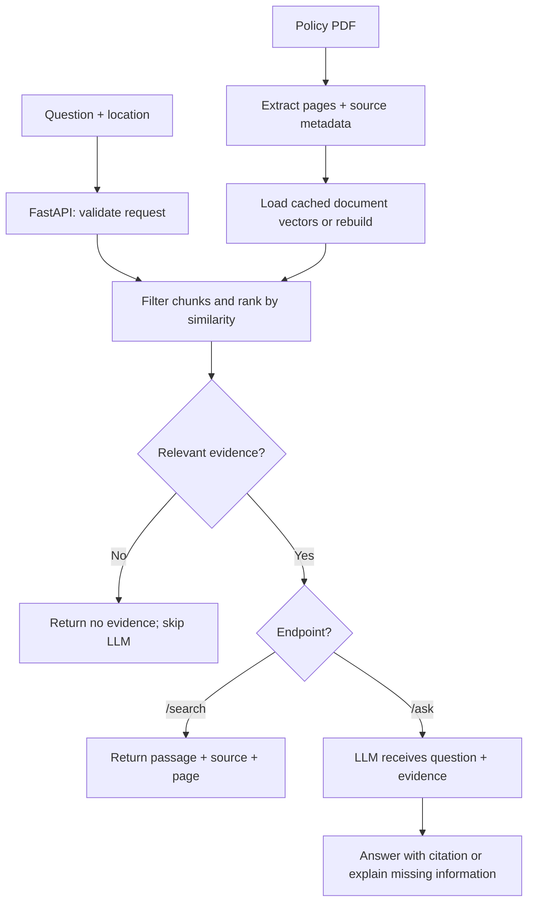

# Weather Tool Calling and RAG Learning Project

A Python learning project combining validated LLM tool calling with PDF-based
retrieval-augmented generation (RAG), exposed through a local FastAPI API.

The weather data and rental policies are fictional practice data. Embeddings
are generated locally; answer generation uses real OpenRouter model requests.

## Process at a Glance



**Retrieve first, generate second.** `/search` returns evidence without an LLM
call. `/ask` uses that evidence to answer. A relevant passage can still lack the
requested detail. Cached vectors save document-embedding work; each question
still needs its own embedding.

## Learning Source

Built while studying [AI Engineering from Scratch](https://github.com/rohitg00/ai-engineering-from-scratch).
The weather example loads its lookup function from the cloned curriculum.

## Project Files

| File | Purpose |
|---|---|
| `lesson.py` | Weather validation, argument parsing and dispatch |
| `test_lesson.py` | Seven tool/parser tests |
| `live_weather.py` | Model-to-tool-to-answer demonstration |
| `document_ingestion.py` | Earlier text-file chunking exercise |
| `pdf_ingestion.py` | PDF extraction, cleanup and page metadata |
| `data/rental_policy.pdf` | Current three-page fictional policy |
| `data/rental_policy.txt` | Earlier text-file policy |
| `embedding_cache.py` | Content/configuration-based local vector cache |
| `check_cache.py` | Manual cache-invalidation experiment |
| `filtered_semantic_search.py` | Filtering and thresholded semantic retrieval |
| `evaluate_retrieval.py` | Eleven chunk-ID-and-page checks |
| `rag_demo.py` | Reusable answer_question function and guarded CLI demo |
| `api.py` | FastAPI request/response models and endpoints |
| `test_api.py` | Six API/service-boundary tests |
| `real_embeddings.py` | Embedding and similarity learning exercise |
| `semantic_search_practice.py` | Invented vectors and distance learning exercise |

## Setup

Use a Python version compatible with the installed dependencies. Development
has included Python 3.14 on Linux; dependencies are not pinned yet.

```bash
git clone https://github.com/mouadrarhib/weather-tool-calling-demo.git
cd weather-tool-calling-demo
git clone https://github.com/rohitg00/ai-engineering-from-scratch.git
python3 -m venv .venv
source .venv/bin/activate
python -m pip install openai python-dotenv pypdf fastapi uvicorn httpx
python -m pip install torch --index-url https://download.pytorch.org/whl/cpu
python -m pip install sentence-transformers
```

The curriculum clone is required for the weather example. Keep `data/` beside
the Python modules. The first embedding-model run downloads weights from
Hugging Face. Local retrieval and mocked tests need no OpenRouter key.

For live generation:

```bash
cp .env.example .env
chmod 600 .env
```

Set this variable in `.env` using your real key locally:

```dotenv
OPENROUTER_API_KEY=your_actual_key_here
```

Never commit `.env`. Keep `.venv/`, `.cache/`, `__pycache__/`, and the nested
curriculum clone excluded through `.gitignore`. The key stays on the backend.

## Weather Tool Calling

The model proposes a tool name and JSON arguments. The application parses and
validates them, executes the permitted weather lookup, and sends its result
back with the matching tool_call_id for a final model response.

```bash
python lesson.py
python live_weather.py
python -m unittest -v test_lesson
```

Seven automated tests passed for missing arguments, unknown tools, blank input,
city cleaning, simulated lookup connection failure, malformed argument JSON,
and list arguments. Mocked tests make no LLM requests.

Tokyo and London sample-weather responses and an Atlantis CITY_NOT_FOUND
response were demonstrated. Weather model calls handle rate limits, timeouts,
and connection failures, but those standalone script handlers do not yet have
provider-error mock tests. The demo supports one tool-execution round.

## PDF Ingestion and Semantic Retrieval

```bash
python document_ingestion.py
python pdf_ingestion.py
python filtered_semantic_search.py
```

The current loader extracts selectable text using pypdf, removes known repeated
headers/footers, and creates one chunk per page. This suits the practice PDF:

| Chunk ID | Page | Section |
|---|---:|---|
| rental-pdf-01 | 1 | Cancellation |
| rental-pdf-02 | 2 | Vehicle maintenance |
| rental-pdf-03 | 3 | Pickup requirements |

Location (Casablanca) and active status are assigned metadata, not facts
extracted from the PDF. Empty cleaned pages raise an error for inspection.
Scanned documents need OCR, which is not implemented. Page-based chunking and
these cleanup rules are not general solutions for arbitrary PDFs.

The embedding model is `sentence-transformers/all-MiniLM-L6-v2`, generating
384-dimensional vectors on CPU, primarily for English text. Metadata filters
select applicable chunks; cosine similarity ranks them highest first. Scores
are relevance measures, not probabilities of answer correctness.

The result includes the chunk ID, text, source filename, page number, and similarity score.

Document vectors persist in `.cache/document_embeddings.npz`. The PDF is still
read and the model loaded each process; valid cached document vectors are reused.
No vector database is used. Each new question still gets its own embedding.

Editing the file while the process is running does not automatically refresh
the prepared chunks or vectors. Reload them after document changes.
Changing the embedding model also requires rebuilding the corresponding vectors.

### Cache Validation

A SHA-256 fingerprint covers extracted chunks and metadata, model name, cache
version and the explicit normalization setting. Matching caches are checked for
shape and finite values. Selected read errors trigger rebuilding. The cache uses
NumPy with allow_pickle=False and writes through a temporary file.

Demonstrated: first-run creation, second-run reuse, rebuilding after an in-memory
chunk text change, rebuilding when original content was restored, and reuse on
the following unchanged run. All eleven retrieval checks also passed from cache.

```bash
python check_cache.py
python filtered_semantic_search.py
python filtered_semantic_search.py
```

The check temporarily changes the cached chunk set without editing the PDF.
The two following retrieval runs restore and then reuse the original vectors.

Model revisions and package versions are not pinned. Changes to upstream weights
under the same model name are not detected. Update the cache configuration/version
when embedding settings change. No speed benchmark has been recorded.

## RAG Prototype

RAG means retrieval-augmented generation: retrieve relevant evidence,
then provide it to a model when generating an answer.

### Workflow

```text
Local policy PDF
→ text extraction and header/footer cleanup
→ page-aware chunks
→ chunk embeddings loaded from a valid cache or rebuilt

User question
→ filter applicable chunks
→ compare embeddings
→ select relevant evidence
→ send question and evidence to the LLM
→ answer with a source or acknowledge missing information
```

### Run

```bash
python rag_demo.py
```

Change the question passed to `answer_question()` in the guarded CLI example
to try another question. Other modules can import this function without a model
API request. The imported retrieval module still loads the embedding model.

`answer_question(question, location="Casablanca")` returns `found`, `answer`,
and `passage`. It retrieves before loading API credentials or creating the model
client. A context manager closes that client after generation.

When evidence is selected, the script makes one OpenRouter model request.
When retrieval returns `None`, it skips answer generation.

### Demonstrated Supported Answer

Question:

> What is the cancellation fee?

Retrieved evidence includes both the free-cancellation period and fee.

Observed answer:

- Free if cancelled at least 24 hours before pickup.
- 100 MAD if cancelled less than 24 hours before pickup.

The PDF-based answer cited `rental_policy.pdf`, page 1, chunk `rental-pdf-01`.

The earlier cancellation-method example also produced a supported answer
explaining that cancellation is available from the customer's account.

### Demonstrated Missing Information

Question:

> Is the cancellation fee refundable?

The cancellation chunk is relevant and specifies the fee, but says nothing
about refundability.

Observed through POST /ask using PDF evidence: the model explained that
refundability was unspecified, without inventing a refund rule, and returned
the cancellation passage with page 1 metadata.

Relevance and answerability are separate.
A related chunk does not necessarily support the requested answer.

### No-Evidence Behaviour

For unrelated questions, retrieval can reject low-similarity candidates.
When retrieval returns `None`, the script displays:

```text
No sufficiently relevant evidence was found in the applicable documents.
```

No OpenRouter request is made on this path.

This behaviour was demonstrated with an unrelated cooking question before
the move to file-based chunks. The updated local retrieval evaluation also
checks unrelated cooking and geography questions.

## Retrieval Evaluation

Run:

```bash
python evaluate_retrieval.py
```

This evaluation runs locally without calling OpenRouter.

### Current Dataset

Eleven manually labelled cases cover:

- Cancellation questions with different wording
- Vehicle maintenance questions
- Pickup identification and driving-licence requirements
- A location with no applicable chunks
- The cancellation fee, now supported by the document
- Fee refundability, which remains unspecified
- Unrelated geography and cooking questions

Each case records an expected chunk ID and expected page number, or `None`
for both when no result is expected.
The `answer_supported` field records a human-assigned expectation about
whether the applicable document contains enough information to answer.

### Observed Results

All eleven checks passed against the PDF chunks, verifying both the retrieved
chunk ID and page number. The existing threshold remained unchanged.

Example observed similarities:

| Question | Selected chunk | Similarity |
|---|---|---:|
| How can I cancel my booking? | `rental-pdf-01` | 0.727 |
| What is the cancellation fee? | `rental-pdf-01` | 0.696 |
| Are the cars maintained regularly? | `rental-pdf-02` | 0.451 |
| Is the cancellation fee refundable? | `rental-pdf-01` | 0.666 |
| What documents should I bring when picking up the car? | `rental-pdf-03` | 0.559 |

The refundability question has a relatively high relevance score,
but the chunk does not contain its answer.

PASS requires both the retrieved ID and page to match their expected values,
including `None` for no-result cases.
It does not mean an LLM answer was automatically checked for correctness.

The earlier 9/9 result evaluated the previous hard-coded sample passages.
The intermediate 10/10 result evaluated text-file chunks.
The current 11/11 result evaluates PDF chunk IDs and page metadata.
These are different dataset versions and are not directly comparable
as a measure of improvement.

The evaluation is small and development-oriented.
It does not establish general RAG reliability.

### Similarity Threshold

`retrieve_passage` defaults to:

```python
min_similarity=0.3
```

It returns `None` when:

- No chunks match the metadata filters, or
- The highest similarity is below the threshold.

The threshold was originally selected using the earlier sample passages.
It remained unchanged for the text-file and PDF evaluations.

It is not a universal cutoff and requires broader evaluation.
Similarity does not establish answer completeness or correctness.

## FastAPI Backend

Start the local development server from the project directory:

```bash
python -m uvicorn api:app --reload
```

Wait for startup to finish. The retrieval module loads the model and prepares
or loads the embedding cache during import. With reload enabled, code changes
restart this process.

Interactive documentation: http://127.0.0.1:8000/docs

### Request Validation

Both POST endpoints accept:

```json
{
  "question": "What is the cancellation fee?",
  "location": "Casablanca"
}
```

`location` defaults to Casablanca. Surrounding whitespace is stripped.
Questions must contain 1–2000 characters and locations 1–100 characters after
stripping. Blank questions return HTTP 422 before retrieval or generation.

### POST /search

Returns local retrieval results without an LLM request. Example HTTP 200 body:

```json
{
  "found": true,
  "passage": {
    "id": "rental-pdf-01",
    "text": "CANCELLATION\n...",
    "source": "rental_policy.pdf",
    "page": 1,
    "similarity": 0.6955652832984924
  }
}
```

The text above is abbreviated for readability. With no qualifying evidence:

```json
{
  "found": false,
  "passage": null
}
```

An empty result is a valid search outcome, not an HTTP error.

### POST /ask

Uses `answer_question()` to retrieve evidence and, only if found, request an
answer from OpenRouter. Returns HTTP 200 with:

- `found`: whether a sufficiently relevant passage was retrieved.
- `answer`: generated text, or the no-evidence explanation.
- `passage`: source evidence with ID, filename, page and similarity, or null.

`found: true` does not guarantee the passage answers every requested detail.
The refundability case found evidence while correctly acknowledging a missing rule.

No-evidence response:

```json
{
  "found": false,
  "answer": "No sufficiently relevant evidence was found in the applicable documents.",
  "passage": null
}
```

This path skips creation of the model client. API credentials are only required
when generation is needed. The endpoint is synchronous because retrieval and
the model SDK calls are blocking operations.

### HTTP Error Mapping

| Condition | API status |
|---|---:|
| Invalid request body, including blank question | 422 |
| Provider rate limit | 503 |
| Provider connection failure | 503 |
| Provider timeout | 504 |
| Other model API status error | 502 |
| Runtime configuration or empty-answer error | 500 |

These are this application's mappings. In particular, an upstream 429 maps
to our 503 response. Responses expose generic messages rather than provider
credentials or raw exception details. The current RuntimeError handler does
not itself log the underlying exception; structured server logging remains pending.
A timeout does not establish that the provider is down.

### Six Passing API and Service-Boundary Tests

```bash
python -m unittest -v test_api
```

The demonstrated run passed all six tests:

1. Blank /search question returns 422 and never calls retrieval.
2. /ask forwards question/location and returns mocked answer/evidence with 200.
3. Mocked provider timeout maps to 504.
4. Mocked provider connection failure maps to 503.
5. Mocked provider rate limit maps to 503.
6. Actual `answer_question()` with mocked no-evidence retrieval returns early
   without constructing the mocked OpenAI client.

The first five exercise endpoint boundaries. The last exercises service logic
and is not an HTTP endpoint test. None sends a model API request. Importing the
application still initializes the real embedding model and cache; the suite is
not isolated from embedding-model setup or all possible startup network access.

Other error branches, generated factual accuracy and automatic citation
verification are not covered by these six tests.

### Observed Manual API Checks

Through /docs, the learner demonstrated:

- /search cancellation result with source and page 1.
- /search no-evidence response and blank-question validation.
- /ask fee answer with both timing conditions and source/page metadata.
- /ask refundability answer acknowledging missing information.
- /ask unrelated-question response with found=false and passage=null.

These observations supplement the mocked tests; they are not a broad evaluation.

## Limitations and Pending Work

- Weather information is fixed sample data, not a live forecast.
- The rental policy is fictional; current retrieval uses one small text-based PDF.
- PDF cleanup is specific to known headers and footers in this practice file.
- PDF chunking uses one page per chunk; the earlier text loader splits on blank lines.
- Neither splitter enforces token limits or adds overlap.
- OCR, encrypted-document handling, and complex layout/table reconstruction are not implemented.
- Location and status are assigned metadata, not extracted facts.
- Chunk IDs depend on page order for PDFs and section order for the text loader.
- Page metadata checks verify retrieval output, not every generated citation.
- Retrieval returns at most one chunk.
- The provisional similarity threshold needs broader evaluation.
- Document vectors persist in a local file cache, not a vector database.
- The cache is a single-file learning implementation; production concurrency is not addressed.
- The embedding model is primarily intended for English.
- Citations and factual support are prompted, not automatically verified.
- Retrieval checks do not automatically evaluate generated-answer quality.
- Automated ingestion tests and end-to-end RAG tests remain pending.
- FastAPI maps expected model-provider failures to HTTP errors; the standalone RAG CLI does not yet catch them.
- Six API/service-boundary tests cover selected paths, not full generated-answer quality.
- API authentication, per-user authorization, rate limiting and deployment are not implemented.
- No React interface has been implemented in this learning project.
- Weather model-provider error handlers still need automated mock tests.
- Free-provider availability, rate limits, and model selection can vary.
- The weather implementation supports one tool-execution round followed
  by a final model response, not an unrestricted agent loop.
- Runtime dependencies and the curriculum revision are not pinned.

## Next Steps

- Add a React interface with question/location inputs, loading/error states,
  answer display and source/page details.
- Keep the OpenRouter key in the Python backend; never send it to React.
- Configure local development proxying or explicit CORS origins when needed.
- Add authentication and access controls before exposing private documents.
- Improve model initialization, logging, tests and dependency reproducibility.
- Expand retrieval and grounded-answer evaluation beyond the practice PDF.
